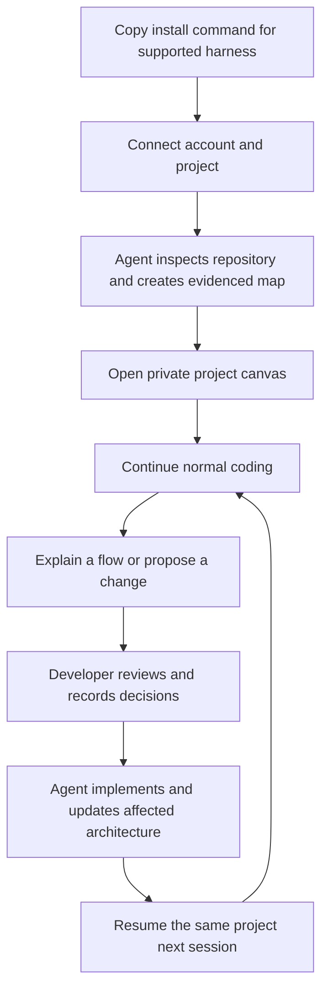
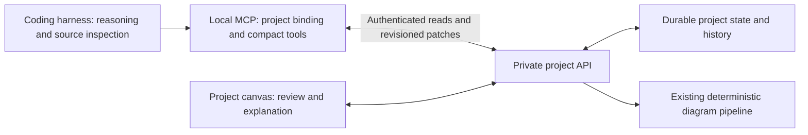

# Agentic ArchDraw — implementation plan

Date: 2026-10-02  
Branch: `agentic`  
Status: Proposed implementation backlog; no product changes implemented by this document.

## 1. Product outcome

ArchDraw becomes a persistent visual workspace for a codebase, maintained by the developer's coding agent. Developers install the integration once, understand existing architecture, discuss proposed changes visually, and return to an updated map in later sessions.

The coding harness performs model inference using its existing configuration. ArchDraw provides structured state, deterministic rendering, synchronization, and the visual experience. The new workflow must not call ArchDraw's paid generation pipeline or request the user's model API key.

Commercial direction: one project free; paid access for additional projects. A project can contain multiple views and proposals. Branches, worktrees, and sessions do not independently consume paid project slots.

### First complete experience



Installation instructions can encourage this workflow, but cannot guarantee every harness will invoke tools automatically. Validate actual behavior in the first supported harness, disclose restart/approval requirements, and provide an explicit fallback invocation.

## 2. Findings from the current code

| Area | Observed implementation | Required change |
|---|---|---|
| Distribution | `mcp-server/package.json` defines `@hiabhee/archdraw-mcp-server`, a bin entry, and compiled distribution. Publication availability was not checked. | Add installation, connection, diagnostic, upgrade, and uninstall workflows. |
| MCP tools | `mcp-server/src/index.ts` registers generation, state, updates, validation, layout, templates, export, and checkpoints. Tool descriptions include substantial formatting guidance and restrictive topology instructions. | Add a compact project workflow; remove instructions that distort legitimate architecture; retain compatibility for existing callers. |
| Working state | `mcp-server/src/lib/diagram-state.ts` uses process-local maps keyed by working session. | Durable project and branch identity, restart recovery, authoritative revisions. |
| Checkpoints | `mcp-server/src/lib/checkpoints.ts` keeps checkpoints in memory. | Persist project-scoped history and restore as a new revision. |
| Generation | Active Mermaid path in `generate-diagram.ts` sends a dry-run request to `/api/diagram/load`; structured input is converted to Mermaid. | Reuse deterministic rendering, preserve semantic metadata, and accurately disclose remote diagram processing. The commented legacy ELK body is not the active generation path. |
| Hosted state | `/api/diagram/load` creates `SharedCanvas` records; MCP writes use an update token and expected revision. This route sets seven-day expiration. | Private authenticated project storage with durable access and revision-controlled mutations. |
| Session reads | `/api/diagram/session/[sessionId]` reads shared state without authentication, returns `source: 'manual'`, and omits its revision. | Do not use shared sessions as the private project transport. |
| Canvas connection | `Canvas.tsx` imports a session into a canvas and changes the URL to `?canvas=...`. | A persistent project/view binding with fresh state, reconnect behavior, and explicit sync status. |
| Update behavior | `update-diagram.ts` supports incremental edits, but returns complete nodes/edges and uses separate placement/style defaults. | Compact results, semantic patches, canonical rendering, and preserved user layout. |
| Visual foundation | React Flow, shape registry, optical sizing, precision/sketch rendering, Mermaid→Dagre layout, and export exist. | Extend these systems for project views and proposal overlays. |
| Landing | `app/page.tsx` renders `components/landing/RevampedLanding.tsx`. | Installation-first hero and a real workflow demonstration. |

Important privacy distinction: unpublished MCP state is held in memory, but Mermaid content is still sent to the configured API for rendering. Do not describe today's path as fully local or offline.

## 3. Proposed architecture and boundaries

Recommended first release: a local stdio MCP integration connected to an authenticated hosted project workspace. The hosted workspace is the authority for synchronized state. Local files hold a project binding and recoverable pending operations, not a competing silently merged master copy.



### Logical contract to specify before implementation

- **Project:** stable opaque ID, owner, repository association, connection status, entitlement.
- **Branch/workspace context:** project ID plus branch/worktree identity and base commit. An unmerged branch must not overwrite the default branch's map.
- **Architecture:** stable component and relationship IDs, responsibilities, evidence, and revision. Renaming a label does not replace identity.
- **Evidence:** repository-relative path, optional symbol/line range, observed commit or content hash, and origin (`code`, `documentation`, `inference`). Line references are hints; stale references must be detectable.
- **View:** architecture/explanation/proposal, selected component IDs, focus/filters, layout, and human annotations. Multiple views reference the same component identities.
- **Proposal:** base architecture revision, proposed operations, decisions, lifecycle (`draft`, `accepted`, `implemented`, `rejected`). Acceptance alone does not establish implementation.
- **Mutation:** expected revision, idempotency key, actor, operations, affected IDs, result revision. Atomic validation precedes persistence.
- **Verification:** what the agent actually checked and its result. Supplied evidence is not proof that behavior works; never manufacture a passing test status.

Keep semantic state separate from React Flow coordinates and visual preferences. Render-style and color-theme contracts remain orthogonal. Concrete database schema and indexes are an implementation task, requiring the applicable database skills before authoring migrations.

### Data and connection policy

- Authenticate private project reads and writes; account ownership must be enforced server-side.
- Pair through a short-lived browser connection flow; persist a revocable, project-scoped credential outside tracked repository files. Do not expose credentials in tool results or URLs.
- Installation establishes permission for private project synchronization. Public sharing remains a separate explicit action.
- Send selected architecture metadata and references by default. Do not upload repository source trees, secrets, or raw prompts automatically.
- Offline operations show pending status. On reconnect, reject stale conflicting operations instead of silently overwriting newer work.
- No always-running daemon or background model loop is required for the first release. The harness starts MCP; the browser reconnects when opened.

## 4. Delivery backlog

Each phase is a reviewable implementation batch. Checkboxes below are intentionally incomplete.

### Phase 0 — contracts and experience specification

Dependencies: none.

- [x] **AG-001:** Select OpenCode as the first harness target based on the tracked `opencode.json` and MCP package configuration. Official OpenCode docs confirm local stdio MCP servers and project `AGENTS.md` instructions. The installer must recognize the supported config format: this repo uses the legacy `mcp.<name>` shape while current v2 docs nest servers under `mcp.servers`. Validate invocation and restart behavior in a fresh repository before release.
- [x] **AG-002:** Finalize project/branch identity and the logical contract above. Repository remotes are matching hints, not authorization. Forks require an explicit existing/new project choice. The hosted project store is authoritative; worktree files hold binding/cache/pending operations only. See [`agentic-workflow-contract.md`](agentic-workflow-contract.md).
- [x] **AG-003:** Specify the five primary screens and recovery states in [`agentic-workflow-contract.md`](agentic-workflow-contract.md).
- [x] **AG-004:** Add small, grouped, and large Mermaid fixtures under [`agentic-fixtures/`](agentic-fixtures/README.md). Counts refer to architecture components, excluding visual group containers.
- [ ] **AG-005:** Record measured tool and response sizes, canonical layout output, and setup steps. Initial static baseline is in [`agentic-workflow-contract.md`](agentic-workflow-contract.md); response/layout measurements still need a reproducible fixture runner and a named reference tokenizer before this item is complete.

Exit gate: one documented workflow with defined states and failure behavior; no unresolved choice about the authoritative project store or first harness. The contract and harness decisions are recorded; Phase 1 can proceed while AG-005 measurements are captured before setting performance targets.

### Phase 1 — durable private project foundation

Dependencies: Phase 0 contracts.

- [x] **AG-010:** Add additive project/workspace/revision/view/proposal persistence and owner-authenticated project read/create APIs. New tables enable RLS and revoke Supabase client-role grants; existing canvas records are untouched. MCP credentials and revisioned writes remain in AG-011/012.
- [ ] **AG-011:** Implement account pairing, scoped credentials, revocation, project binding, and resume. Support repositories without remotes.
  - Partial implementation: short-lived browser approval, activation of a project-scoped credential after approval, scoped read authentication, and owner revocation are in place. MCP-side credential storage, persistent worktree binding, and restart resume remain before this item is complete.
- [ ] **AG-012:** Add atomic revision checks, idempotency, durable checkpoints, and branch isolation. Distinguish repository commit freshness from document revision.
- [ ] **AG-013:** Add a project/view route that reuses the editor. Legacy `?session=` URLs remain explicit shared-diagram imports.
- [ ] **AG-014:** Add project synchronization to the store: start with revision-aware polling while the view is visible, bounded backoff, and immediate refresh on focus. Keep transport replaceable if later measurement justifies push updates.

Starting points: `mcp-server/src/lib/diagram-state.ts`, `checkpoints.ts`, `frontend/app/api/diagram/`, `frontend/lib/db.ts`, `frontend/prisma/schema.prisma`, `frontend/store/diagram/slices/persistenceSlice.ts`, `frontend/store/diagram/persistence/dbSave.ts`, `frontend/components/Canvas.tsx`.

Acceptance: restart MCP and reopen the browser to recover the same map; a different account cannot read it; two conflicting writes cannot silently overwrite each other; retrying an operation does not duplicate it; branches remain isolated.

### Phase 2 — agent workflow and compact tools

Dependencies: Phase 1; visual work in Phase 3 begins alongside this phase.

- [ ] **AG-020:** Add project capabilities for connect/resume, scoped read, semantic patch, explanation/proposal creation, decision retrieval, and opening a view. Final names and schemas must be versioned and documented.
- [ ] **AG-021:** Return compact results by default: project/view IDs, revision, changed IDs, warnings, and private URL. Full graph and evidence detail are opt-in, paginated or bounded.
- [ ] **AG-022:** Add short harness instructions: resume before inspection, inspect only relevant code, explain visually when useful, update after meaningful architectural changes, and disclose stale/uncertain findings.
- [ ] **AG-023:** Implement evidence and freshness handling. Use changed file paths to identify potentially affected components; mark them stale until inspected. Missing analysis must not imply deletion.
- [ ] **AG-024:** Implement proposal lifecycle and developer decisions. Agents retrieve decisions during task work; the canvas does not promise to wake a dormant harness.
- [ ] **AG-025:** Route rendering through the existing deterministic pipeline. Prohibit model-provider calls on this new path and remove duplicated full graph output from the new compact contract.
- [ ] **AG-026:** Introduce an opt-in project tool profile while retaining legacy tool schemas/behavior. Document compatibility and migration; shorten misleading topology guidance within the authorized implementation scope.

Starting points: `mcp-server/src/index.ts`, `src/lib/schema.ts`, `src/types/index.ts`, `src/tools/read-me.ts`, `generate-diagram.ts`, `update-diagram.ts`, `frontend/lib/mermaid/pipeline.ts`.

Acceptance: map a repository, explain its upload flow, propose a worker, record a database-backed queue decision, implement, and patch the current map. No ArchDraw model-provider request occurs. Rejected/unimplemented proposals never appear as current architecture.

### Phase 3 — visual design and seamless canvas experience

Dependencies: Phase 0 design fixtures and Phase 1 project binding. Required for the first pilot, not post-launch polish.

- [ ] **AG-030:** Refine typography, concern colors, grouping, edge labels, and hierarchy using existing tokens. Define clear current/proposed/removed/uncertain states with text or patterns as well as color.
- [ ] **AG-031:** Add focused views, breadcrumbs back to the overview, and an evidence/decision inspector. Open the exact view referenced by the agent without dashboard navigation.
- [ ] **AG-032:** Preserve positions for semantic-only changes. Place additions in the affected region and recompute affected group bounds. Explicit full arrange continues through `layoutDiagramViaMermaid`; do not introduce a second layout engine.
- [ ] **AG-033:** Separate semantic changes from user coordinates, annotations, and view preferences. Prevent automatic fit-view jumps while someone is inspecting a diagram.
- [ ] **AG-034:** Display initial mapping, ready, updating, stale, pending, disconnected, conflict, and failed states with a useful next action.
- [ ] **AG-035:** Review keyboard operation, focus handling, reduced motion, readable contrast, light/dark themes, and export parity for the new states.

Starting points: `frontend/views/Editor.tsx`, `components/Canvas.tsx`, `components/PropertiesPanel.tsx`, `lib/theme/stylingConstants.ts`, `lib/theme/shapeGeometry/`, `lib/utils/nodeSizing.ts`, `lib/mermaid/relayout.ts`, `store/diagram/slices/`.

Acceptance: fixture diagrams have no node overlaps or clipped labels at their intended detail level; a focused flow is traceable; renaming a component leaves all positions unchanged; inserting a component preserves unrelated and pinned positions; canvas/export state labels agree.

### Phase 4 — installer and onboarding

Dependencies: Phases 1–3 working end to end.

- [ ] **AG-040:** Add installer/connection/diagnostic entry points to the MCP package. Keep MCP stdout protocol-clean and send CLI diagnostics to the appropriate output channel.
- [ ] **AG-041:** Implement the first harness adapter with safe configuration merging and project-local instructions. Re-running setup must not duplicate entries or overwrite user instructions.
- [ ] **AG-042:** Handle package/runtime prerequisites, unsupported versions, authentication cancellation, connection failure, and any required harness restart.
- [ ] **AG-043:** Include clean upgrade and uninstall paths. Uninstall removes only owned configuration; project deletion and credential revocation are explicit operations.
- [ ] **AG-044:** Validate the actual packaged artifact in a fresh external repository, then publish through the normal authorized release process. The hero command must reference an available tested package.

Acceptance: a new developer copies one command, finishes the required pairing, and gets their own map without hand-editing config. A second install is harmless. Upgrading preserves identity and uninstall leaves unrelated configuration intact.

### Phase 5 — landing page and pilot release

Dependencies: Phase 4 installer verified.

- [ ] **AG-050:** Redesign `RevampedLanding` around “Understand what your coding agent is building,” a supported harness selector, the real copy command, and one-project-free messaging.
- [ ] **AG-051:** Demonstrate current architecture → explanation → proposal → implemented update using the production visual components. Update page metadata, MCP documentation, and onboarding copy to match supported behavior.
- [ ] **AG-052:** Record privacy-conscious activation events: install started/completed, project connected, first map, first explanation, first update, and return session. Avoid source content and model prompts in analytics.
- [ ] **AG-053:** Run five real-repository pilot sessions; fix setup, fidelity, sync, and visual problems before wider promotion.

Pilot gate: at least four of five users complete setup without configuration assistance, and at least three voluntarily return for another task. These are experiment thresholds, not evidence of product-market fit.

### Phase 6 — project entitlements and paid expansion

Dependencies: stable project identity; billing release follows pilot evidence.

- [ ] **AG-060:** Separate project entitlements from current hosted AI-generation quotas. Existing generation endpoints retain their applicable protections.
- [ ] **AG-061:** Enforce one free project server-side, atomically under concurrent creation. Views, branches, worktrees, and reconnects share that project's slot.
- [ ] **AG-062:** Define paid allowance, pricing, archive/deletion behavior, downgrade behavior, and grace periods before checkout work. Recommended downgrade behavior preserves readable/exportable existing work.
- [ ] **AG-063:** Implement billing only after provider and pricing decisions; validate duplicate/delayed webhook handling and reconciliation.
- [ ] **AG-064:** Add additional harness adapters using the same project contract and measured integration tests.

Acceptance: second-project creation produces a useful upgrade path; cloning/reconnecting the same project consumes no extra slot; concurrent creates cannot bypass limits; billing retries never double-apply entitlements.

### Later — database schema and additional views

- [ ] **AG-070:** Add schema views with tables, columns, keys, relationships, and links to schema/migration files. Start with repository schema artifacts; live production database credentials are not needed for the first schema view.
- [ ] **AG-071:** Add schema proposal diffs and migration explanations using the existing proposal/evidence model.
- [ ] **AG-072:** Evaluate API and deployment views from observed demand. Keep project identity, evidence, and history shared across view types.

## 5. Token and performance budget

Proposed engineering targets, to measure and revise in Phase 0:

| Operation | Initial target |
|---|---|
| Project-profile tool descriptions plus startup guidance | At most 2,000 tokens using a documented reference tokenizer; record tokenizer/version. |
| Resume summary | At most 800 tokens by default. |
| Mutation acknowledgment | At most 300 tokens, excluding explicitly requested details. |
| Update three components in a 50-component fixture | At least 70% fewer exchanged tool tokens than full-state read/write on the same fixture. |
| No-op task completion | No full repository scan or regenerated map. |
| Visible canvas synchronization | p95 within five seconds of a committed update on the documented pilot environment. |
| First useful map | Measure separately by repository size and harness; never promise a fixed time independent of model/repository. |

Report tool payload tokens separately from model inference tokens. Use harness usage reporting where available; label estimates when full inference usage is unavailable. Measure retries and tool-schema overhead, not only successful response size.

## 6. Practical validation and release gates

For implementation batches, run colocated Vitest tests for touched code. Run package typechecks/builds as applicable and existing regression suites before release. This planning change does not require running application tests.

Suggested implementation commands, from their respective directories:

```sh
# mcp-server/
npm test
npm run build

# frontend/
npm test -- <touched-test-path>
npx tsc --noEmit
npm run lint
```

Required scenario checks:

1. Install in a fresh repository, repeat installation, restart the harness, and reopen the same private project.
2. Try reading/writing with no credential, another account, and a revoked credential; verify denial without data disclosure.
3. Update from two sessions at the same revision; one succeeds and the other receives a conflict with recovery guidance.
4. Retry a successful mutation after a simulated lost response; exactly one revision is applied.
5. Disconnect, edit, reconnect, and resolve a stale pending operation without losing the newer server version.
6. Create a branch proposal; verify the default branch map is unchanged until the implementation is reconciled against that branch's code.
7. Rename a component and add a worker; verify evidence, human notes, pinned positions, and unrelated layout survive.
8. Reject a proposal; verify it remains outside current architecture and its decision is available to the agent.
9. Remove model-provider credentials in a test environment and intercept provider requests; the new agent workflow still works with zero provider calls from ArchDraw.
10. Review all design fixtures in light/dark and precision/sketch modes, including keyboard navigation, focus, export, and reconnect states.
11. Measure initialization, explanation, no-op resume, and incremental update tool usage on the same fixture and record results.
12. Create projects concurrently and reconnect a clone; validate the free allowance and identity behavior.

## 7. Rollout and scope controls

- Introduce project mode behind a feature flag. Retain existing diagram generation and legacy MCP clients during migration.
- Make migrations additive first; explicitly attach/import legacy canvases when requested. Never silently promote public shared links into private project records.
- Preserve checkpoints before bulk reconciliation; rollback disables new entry points while leaving project data available for recovery/export.
- Update `AGENTS.md` when canonical project/tool/persistence paths actually ship. Record new API contracts alongside their implementation.
- No broad rewrite of the AI/repo pipelines, no new layout engine, no multi-agent orchestration platform, and no production database introspection in the first release.

## 8. Immediate implementation order

1. AG-001–005: settle contracts, first harness, design fixtures, and baselines.
2. AG-010–014: private project persistence, authentication, revisions, and a connected canvas.
3. AG-020–026 plus AG-030–035: real agent workflow and polished visual experience.
4. AG-040–044: package that workflow into installation and recovery.
5. AG-050–053: promote it through the landing page and validate with real developers.
6. AG-060–064: enforce project entitlements and release paid expansion.

Success is a returning developer whose agent maintains a trustworthy, readable project map with little prompting and bounded context cost. Installation counts alone do not establish that outcome.
